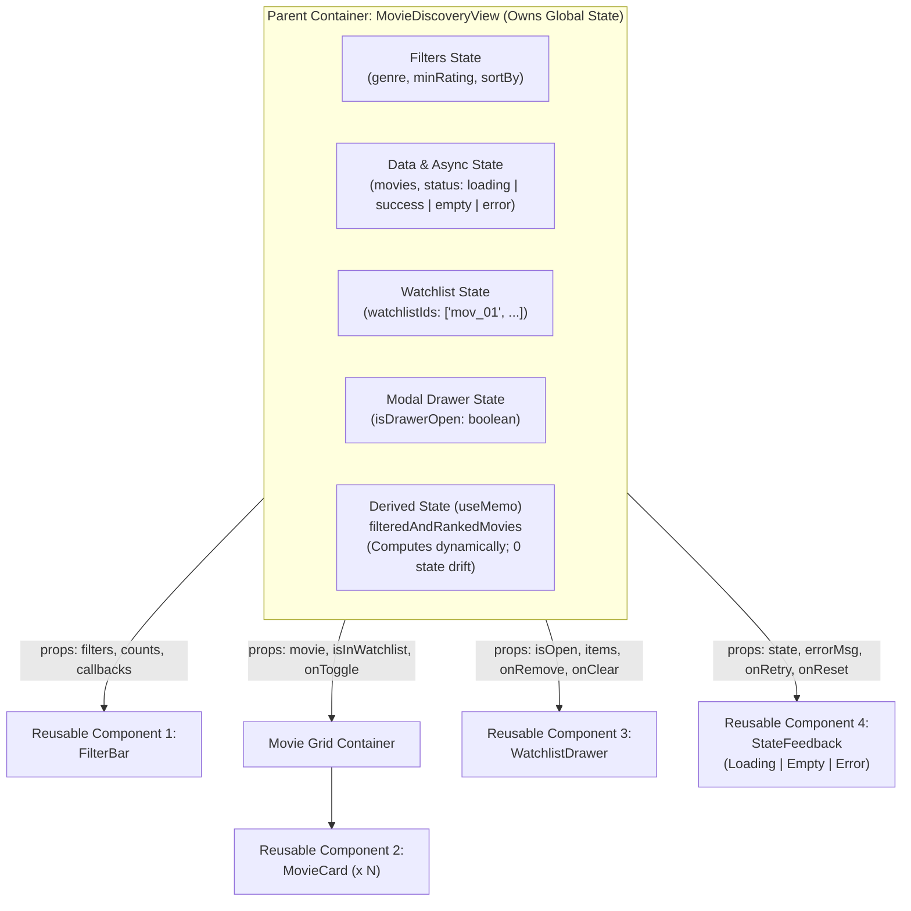

# Day 5 – React State & Component Design

## Context: Movie Discovery App (Filters, Watchlists & Recommendation Ranking)
An interactive movie recommendation dashboard enabling users to explore personalized AI-ranked recommendations, filter by genre, adjust minimum rating thresholds, rank by match scores or release dates, and curate a persistent watchlist with optimistic UI updates.

---

## 1. State Ownership Architecture



### State Ownership Rationale:

| State Field | Owner Component | Rationale & Architectural Choice |
| :--- | :--- | :--- |
| **`filters`** (`genre`, `minRating`, `sortBy`) | `MovieDiscoveryView` (Parent) | **Lifting State Up**: Filters directly influence the recommendation ranking algorithm and derived dataset. Lifting state allows `FilterBar` to remain a pure controlled presentation component while the parent synchronizes the movie feed. |
| **`status`** (`loading`, `success`, `empty`, `error`) | `MovieDiscoveryView` (Parent) | **Centralized Async Coordinator**: Coordinates whether to display skeleton shimmer cards, the populated recommendation grid, an empty search banner, or a network retry prompt in `StateFeedback`. |
| **`watchlistIds`** | `MovieDiscoveryView` (Parent) | **Shared Cross-Branch State**: Consumed by three separate branches: (1) `MovieCard` for its `+ Watchlist` / `✓ In Watchlist` button, (2) `WatchlistDrawer` for listing saved movies and handling removals, and (3) `FilterBar` for the header badge count. Single source of truth eliminates state divergence. |
| **`isDrawerOpen`** | `MovieDiscoveryView` (Parent) | **Modal Layout State**: Toggled from the `FilterBar` header button and dismissed by the `WatchlistDrawer` backdrop or close button. |
| **`filteredAndRankedMovies`** | **Derived State** (`useMemo`) | **Never Stored in State**: Recomputed purely as a function of `movies` + `filters`. Storing filtered arrays in separate state causes out-of-sync bugs and double renders. |

---

## 2. Reusable Component Breakdown

### 1. `FilterBar` ([FilterBar.js](file:///Users/alokagrahari/Downloads/DT/src/day5-react/components/FilterBar.js))
- Controlled navigation header providing genre filter pills (`All`, `Sci-Fi`, `Action`, `Drama`, `Thriller`, `Animation`).
- Interactive range slider for minimum IMDb rating (`0.0` to `9.5 ⭐`).
- Dropdown selector for recommendation ranking criterion (`Top Recommendation Match %`, `Highest Rated IMDb`, `Newest Release`).
- Watchlist trigger button displaying the live badge count.

### 2. `MovieCard` ([MovieCard.js](file:///Users/alokagrahari/Downloads/DT/src/day5-react/components/MovieCard.js))
- Displays personalized recommendation match badge (e.g. `98% Match` in emerald green).
- Dynamic styling for movies saved in watchlist (`saved-in-watchlist` class, cyan glow).
- Watchlist toggle button: switches between `+ Watchlist` and `✓ In Watchlist` with optimistic local feedback.

### 3. `WatchlistDrawer` ([WatchlistDrawer.js](file:///Users/alokagrahari/Downloads/DT/src/day5-react/components/WatchlistDrawer.js))
- Sliding side-panel displaying saved films with thumbnail, year, genre, and match score.
- Direct removal buttons (`🗑`) per item and a `Clear Watchlist` action.
- Displays an empty placeholder state when zero films are saved.

### 4. `StateFeedback` ([StateFeedback.js](file:///Users/alokagrahari/Downloads/DT/src/day5-react/components/StateFeedback.js))
- **Loading State**: Animated spinner ring and 6 skeleton shimmer cards simulating asynchronous recommendation queries.
- **Empty State**: Triggered when filters yield zero matching recommendations (e.g. `genre="Animation"` and `minRating=9.8`). Displays a descriptive explanation and a **"Reset Filters"** action button.
- **Error State**: Triggered on network/API failure (e.g. HTTP 503). Displays a descriptive alert banner and an actionable **"↻ Retry Connection"** button.

---

## 3. Recommendation API Contract Example

```http
GET /api/v1/movies/recommendations?genre=Sci-Fi&minRating=8.0&sortBy=matchScore HTTP/1.1
Host: api.cinepulse.ai
Accept: application/json
```

### JSON Response:
```json
{
  "success": true,
  "data": {
    "totalMatches": 2,
    "appliedFilters": {
      "genre": "Sci-Fi",
      "minRating": 8.0,
      "sortBy": "matchScore"
    },
    "recommendations": [
      {
        "id": "mov_01",
        "title": "Interstellar Horizon",
        "year": 2024,
        "genre": "Sci-Fi",
        "rating": 8.8,
        "matchScore": 98,
        "poster": "🌌",
        "backdropColor": "#1e1b4b",
        "tagline": "The boundaries of human endurance tested beyond the stars.",
        "durationMinutes": 169
      },
      {
        "id": "mov_02",
        "title": "Quantum Drift",
        "year": 2023,
        "genre": "Sci-Fi",
        "rating": 8.4,
        "matchScore": 95,
        "poster": "⚡",
        "backdropColor": "#0f172a",
        "tagline": "Time is not a line, it's a labyrinth.",
        "durationMinutes": 124
      }
    ]
  },
  "meta": {
    "requestId": "req_8b2f91a3-41c2",
    "algorithm": "collaborative-filtering-v3.2"
  }
}
```

---

## 4. Test Verification Output

Run the automated Day 5 test suite:
```bash
npm run test:day5
```

```text
══════════════════════════════════════════════════════════════════════════════════
   DAY 5: REACT STATE & COMPONENT DESIGN VERIFICATION TEST RUNNER   
   Context: Movie Discovery App (Filters, Watchlists & Ranking)       
══════════════════════════════════════════════════════════════════════════════════

[PART 1] REUSABLE COMPONENTS SERVER-SIDE HYDRATION & RENDERING
──────────────────────────────────────────────────────────────────────────────────
  [PASS] Test 1: Reusable Component 1: FilterBar Rendering
         Rendered 6 genre pills, active 'Sci-Fi' filter, rating slider, and watchlist badge (2 items)
  [PASS] Test 2: Reusable Component 2: MovieCard Rendering (Unsaved & Saved States)
         Title: "Interstellar Horizon" | Score: 98% Match | Dynamic button: '+ Watchlist' -> '✓ In Watchlist'
  [PASS] Test 3: Reusable Component 3: WatchlistDrawer Rendering (Open vs Closed)
         Open drawer displays 2 saved items with remove buttons; Closed drawer emits 0 DOM nodes

[PART 2] ASYNC STATE FEEDBACK (LOADING, EMPTY, ERROR STATES)
──────────────────────────────────────────────────────────────────────────────────
  [PASS] Test 4: StateFeedback: LOADING State
         Rendered animated spinner, contextual message, and 6 shimmer skeleton cards
  [PASS] Test 5: StateFeedback: EMPTY State
         Rendered empty state graphic, specific criteria explanation, and 'Reset Filters' CTA
  [PASS] Test 6: StateFeedback: ERROR State
         Rendered error alert banner, HTTP 503 description, and '↻ Retry Connection' button

[PART 3] STATE OWNERSHIP, DERIVED STATE & FILTERING ALGORITHMS
──────────────────────────────────────────────────────────────────────────────────
  [PASS] Test 7: Derived State: Genre Filtering Logic
         'Sci-Fi' correctly filters to 2 movies: [Interstellar Horizon, Quantum Drift]
  [PASS] Test 8: Derived State: Minimum Rating Threshold Filtering
         minRating >= 8.5 filters to 3 movies: [Interstellar Horizon (8.8⭐), The Autumn Sonata (8.6⭐), Spirited Forest (8.7⭐)]
  [PASS] Test 9: Recommendation Ranking Sort Verification
         Rank by Match: #98% (Interstellar Horizon) -> #84% | Rank by Rating: 8.8 -> 7.5
  [PASS] Test 10: Watchlist State Mutations (Add, Remove, Clear)
         Verified immutable toggle: [mov_01] -> [mov_01, mov_02] -> [mov_02] -> []
  [PASS] Test 11: Top-Level MovieDiscoveryView Full Integration Render
         MovieDiscoveryView successfully renders complete component tree with 0 runtime errors

══════════════════════════════════════════════════════════════════════════════════
TEST SUMMARY: 11 / 11 TESTS PASSED (100% SUCCESS RATE)
══════════════════════════════════════════════════════════════════════════════════
```

---

## 5. Visual Proof
- **Visual Component Screenshot**: [Screenshot 2026-11-28 Day 5 Movie Discovery React View.png](file:///Users/alokagrahari/Downloads/DT/ss/Screenshot%202026-11-28%20Day%205%20Movie%20Discovery%20React%20View.png)
- **Raw Test Output Log**: [test-output-day5.txt](file:///Users/alokagrahari/Downloads/DT/test-output-day5.txt)
