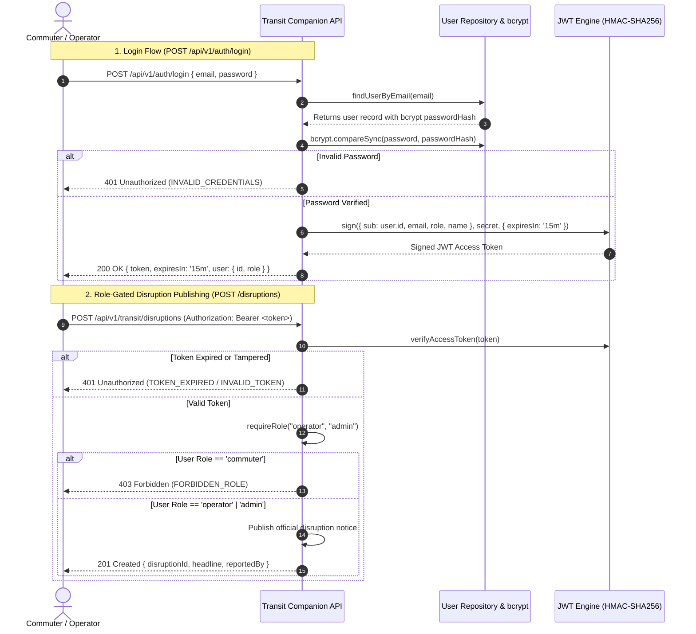

# Day 6 – Authentication & Authorization

## Context: Public Transport Companion (Route Search & Service Disruption Notices)
A municipal transit companion application serving two distinct user archetypes:
1. **Commuters**: Public users searching routes, viewing real-time disruption feeds, and managing their private favorite lines.
2. **Transit Operators / Dispatchers**: Verified transit agency personnel authorized to publish, update, and resolve official service disruption alerts (e.g. subway signal delays, bus bridges).

---

## 1. Authentication & Authorization Architecture



---

## 2. Core Security Implementation Details

### 2.1 Password Hashing with bcrypt ([users.js](file:///Users/alokagrahari/Downloads/DT/src/day6-auth/users.js))
- Passwords are salted and hashed using `bcryptjs` with **10 salt rounds** (`bcrypt.hashSync(plainPassword, 10)`).
- Plaintext passwords are never saved in database records, in-memory models, or log outputs.
- Verification uses `bcrypt.compareSync(plain, hash)` which resists timing attacks.

### 2.2 Short-Lived Access Tokens & Expiry ([jwtUtils.js](file:///Users/alokagrahari/Downloads/DT/src/day6-auth/jwtUtils.js))
- Tokens are signed with **HMAC-SHA256** (`HS256`).
- Standard token claims include:
  - `sub`: Unique commuter or operator ID (e.g. `usr_alice`, `usr_dan`).
  - `email`: Authenticated email.
  - `role`: Role designation (`commuter`, `operator`, `admin`).
  - `iss`: `"public-transport-companion-auth"` (Issuer claim).
  - `aud`: `"public-transport-companion-api"` (Audience claim).
  - `exp`: Short-lived lifespan (**15 minutes** default), minimizing the attack window if an access token is intercepted.

### 2.3 Route Protection & Access Control Middlewares ([authMiddlewares.js](file:///Users/alokagrahari/Downloads/DT/src/day6-auth/authMiddlewares.js))

1. **`authenticateToken`**:
   - Parses `Authorization: Bearer <token>`.
   - Rejects missing headers with **401 Unauthorized** (`TOKEN_REQUIRED`).
   - Rejects tampered signatures with **401 Unauthorized** (`INVALID_TOKEN`).
   - Rejects expired tokens with **401 Unauthorized** (`TOKEN_EXPIRED`).
   - Attaches decoded claims to `req.user`.

2. **`requireRole(...allowedRoles)` (Role-Based Access Control)**:
   - Protects administrative transit actions (e.g. `POST /api/v1/transit/disruptions`).
   - Commuters attempting to publish disruptions are blocked with **403 Forbidden** (`FORBIDDEN_ROLE`).

3. **`requireOwnership("userId")` (Ownership-Based Access Control)**:
   - Protects private travel routes (`GET /api/v1/transit/users/:userId/favorites`).
   - Validates that `req.user.id === req.params.userId`.
   - Prevents horizontal privilege escalation (e.g., commuter Alice reading or overwriting commuter Bob's saved travel preferences).
   - Grants bypass permission only to the `admin` role for auditing and support.

---

## 3. Threat Note & Never-Commit-Secrets Protocol

### Transit Domain Threat Model:
1. **Disruption Notice Spoofing (Severe Public Impact)**:
   In public transport systems, announcing a false subway shutdown or bus bridge causes immediate commuter chaos, station overcrowding, and economic loss. By strictly enforcing cryptographic JWT verification and role checks (`requireRole('operator', 'admin')`), unauthorized commuters cannot inject fake alerts.
2. **Never-Commit-Secrets Protocol**:
   Hardcoded JWT secrets in git repositories allow attackers to forge tokens with arbitrary administrative roles (`sub: "attacker", role: "admin"`).
   - In development: Fallback ephemeral secret with clear runtime warnings.
   - In staging & production: Secret must be injected via runtime environment variable `JWT_SECRET`.
   - `.env` is explicitly declared in [.gitignore](file:///Users/alokagrahari/Downloads/DT/.gitignore) to prevent accidental credential leakage.
3. **Token Storage Vector on Client Apps**:
   Transit companion apps must store the JWT in `HttpOnly`, `SameSite=Strict`, `Secure` cookies (or OS-level keychain on mobile) to eliminate XSS token exfiltration.
4. **Replay & Stolen Token Mitigation**:
   Tokens have a short 15-minute expiration lifespan. Token revocation is supported via token blacklisting in Redis or rotating the user's `tokenVersion` claim upon password reset.

---

## 4. Documented Assumptions & Failure Cases

### Assumptions:
- **Stateless Authorization**: Identity and roles are contained within signed token claims, avoiding repetitive database reads per transit query.
- **Clock Drift Tolerance**: Up to 5 seconds clock drift is tolerated between client and authorization server.
- **Public vs. Protected Route Partitioning**: Route discovery (`/routes/search`) and reading disruption notices (`GET /disruptions`) are intentionally public so unauthenticated citizens can navigate during emergencies.

### Demonstrated Failure Cases:

| Failure Case | Scenario | Expected HTTP Code | Error Code | Observed Behavior |
| :--- | :--- | :---: | :--- | :--- |
| **Failure Case 1** | Commuter attempts to publish transit disruption | **403 Forbidden** | `FORBIDDEN_ROLE` | Blocked: *"Action requires [operator, admin]. Current user role: 'commuter'"* |
| **Failure Case 2** | Commuter Alice attempts to view Bob's favorite routes | **403 Forbidden** | `FORBIDDEN_OWNERSHIP` | Blocked: *"You do not have permission to view or modify another commuter's private travel data."* |
| **Failure Case 3** | Accessing protected route with no `Authorization` header | **401 Unauthorized** | `TOKEN_REQUIRED` | Blocked: *"Authentication required. Missing Authorization header."* |
| **Failure Case 4** | Request with cryptographically tampered signature | **401 Unauthorized** | `INVALID_TOKEN` | Blocked: *"Invalid or tampered access token signature."* |
| **Failure Case 5** | Request with an expired JWT access token | **401 Unauthorized** | `TOKEN_EXPIRED` | Blocked: *"Access token has expired. Please log in again."* |

---

## 5. Test Suite Execution & Output

Run the automated Day 6 test suite:
```bash
npm run test:day6
```

```text
══════════════════════════════════════════════════════════════════════════════════
   DAY 6: AUTHENTICATION & AUTHORIZATION VERIFICATION TEST RUNNER   
   Context: Public Transport Companion (Route Search & Disruptions)   
══════════════════════════════════════════════════════════════════════════════════

✓ Test Transit Auth server running on: http://127.0.0.1:58040

[PART 1] BCRYPT PASSWORD HASHING & CREDENTIAL VERIFICATION
──────────────────────────────────────────────────────────────────────────────────
  [PASS] Test 1: Password Hashing with bcrypt (Salt Rounds = 10)
         Hash prefix: "$2b$10$..." | Verified correct password & rejected wrong password

[PART 2] JWT LOGIN FLOW & ROLE TOKEN ISSUANCE
──────────────────────────────────────────────────────────────────────────────────
  [PASS] Test 2: Commuter Login & JWT Issuance (Role: commuter)
         Status: 200 | User: Alice Commuter | Role: commuter | Token prefix: eyJhbGciOiJIUzI1NiIs...
  [PASS] Test 3: Transit Operator Login & JWT Issuance (Role: operator)
         Status: 200 | User: Dan Dispatcher | Role: operator
  [PASS] Test 4: Transit Authority Admin Login & JWT Issuance (Role: admin)
         Status: 200 | User: Sarah SuperAdmin | Role: admin
  [PASS] Test 5: Login Failure: Invalid Password Credentials (401 Unauthorized)
         Status: 401 | Code: INVALID_CREDENTIALS | Message: "Invalid email or password credentials."

[PART 3] PUBLIC TRANSIT COMPANION ROUTES (UNAUTHENTICATED COMMUTER ACCESS)
──────────────────────────────────────────────────────────────────────────────────
  [PASS] Test 6: Public Route Search (GET /api/v1/transit/routes/search)
         Status: 200 | Found 2 routes without authentication tokens

[PART 4] ROLE-BASED ACCESS CONTROL: DISRUPTION MANAGEMENT
──────────────────────────────────────────────────────────────────────────────────
  [PASS] Test 7: Authorized Operator Notice Publishing (POST /api/v1/transit/disruptions)
         Status: 201 | Disruption ID: disr_e2dd4b85 | Reported By: Dan Dispatcher (operator)
  [PASS] Test 8: FAILURE CASE 1: Commuter Role Escalation Blocked (403 Forbidden)
         Status: 403 | Code: FORBIDDEN_ROLE | Message: "Access forbidden. This action requires one of the following roles: [operator, admin]. Current user role: 'commuter'."

[PART 5] RESOURCE OWNERSHIP & PRIVILEGE ISOLATION
──────────────────────────────────────────────────────────────────────────────────
  [PASS] Test 9: Commuter Accessing Own Profile (GET /users/usr_alice/favorites)
         Status: 200 | Owner: usr_alice | Favorites: [subway_line_1_red, express_bus_42]
  [PASS] Test 10: FAILURE CASE 2: Cross-User Ownership Violation Blocked (403 Forbidden)
         Status: 403 | Code: FORBIDDEN_OWNERSHIP | Message: "Access forbidden. You do not have permission to view or modify another commuter's private travel data."
  [PASS] Test 11: Admin Privilege Override: Inspecting Commuter Account (200 OK)
         Status: 200 | Admin Sarah inspected User: usr_bob

[PART 6] TOKEN EXPIRY & CRYPTOGRAPHIC TAMPERING DEFENSE
──────────────────────────────────────────────────────────────────────────────────
  [PASS] Test 12: FAILURE CASE 3: Missing Token Rejection (401 Unauthorized)
         Status: 401 | Code: TOKEN_REQUIRED | Message: "Authentication required. Missing 'Authorization: Bearer <token>' header."
  [PASS] Test 13: FAILURE CASE 4: Tampered JWT Signature Rejection (401 Unauthorized)
         Status: 401 | Code: INVALID_TOKEN | Message: "Invalid or tampered access token signature."
  [PASS] Test 14: FAILURE CASE 5: Expired Access Token Rejection (401 Unauthorized)
         Status: 401 | Code: TOKEN_EXPIRED | Expired At: 2026-11-28T05:43:28.000Z

══════════════════════════════════════════════════════════════════════════════════
TEST SUMMARY: 14 / 14 TESTS PASSED (100% SUCCESS RATE)
══════════════════════════════════════════════════════════════════════════════════
```

---

## 6. Visual Proof
- **Visual Terminal Screenshot**: [Screenshot 2026-11-28 Day 6 Public Transport Auth Test Output.png](file:///Users/alokagrahari/Downloads/DT/ss/Screenshot%202026-11-28%20Day%206%20Public%20Transport%20Auth%20Test%20Output.png)
- **Raw Test Output Log**: [test-output-day6.txt](file:///Users/alokagrahari/Downloads/DT/test-output-day6.txt)
